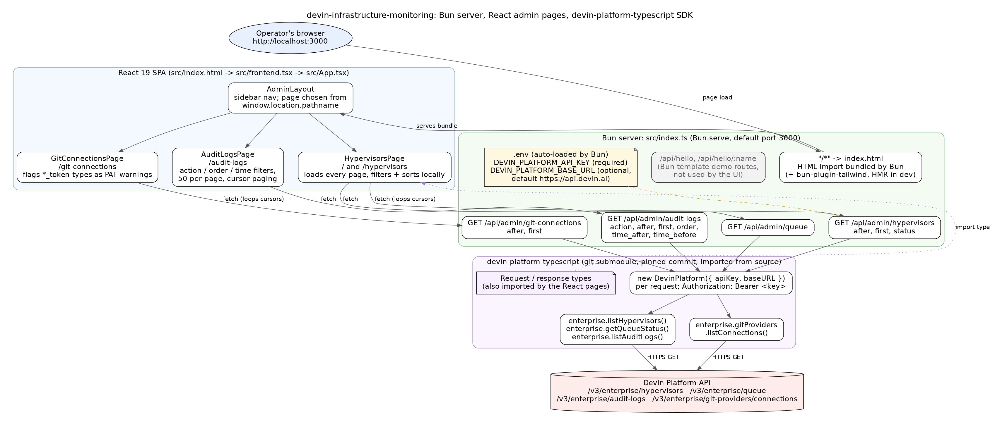

# Devin Infrastructure Monitoring

A small Bun + React admin app ("Devin Observability") for enterprise admins: hypervisor fleet and queue health, the enterprise audit log, and Git connections that still use PATs. It reads the Devin Platform API through the `devin-platform-typescript` SDK, which is a git submodule.

See [docs/architecture.md](docs/architecture.md) for how it fits together.



## Set up from scratch

1. Install Bun if it is not already installed.

2. Clone with the `devin-platform-typescript` submodule (the server and pages import it from source, so the app does not start without it):

   ```bash
   git clone --recurse-submodules https://github.com/COG-GTM/devin-infrastructure-monitoring.git
   ```

   In an existing clone, run `git submodule update --init` instead.

3. Install dependencies:

   ```bash
   bun install
   ```

4. Create a `.env` file from `.env.example`:

   ```bash
   cp .env.example .env
   ```

5. In your Devin enterprise settings, create or request a Devin Platform API service user key with the role:

   ```text
   MB Service User - Observability
   ```

6. Paste that key into `.env`:

   ```bash
   DEVIN_PLATFORM_API_KEY=your_service_user_key_here
   ```

   Optionally set `DEVIN_PLATFORM_BASE_URL` to point at a different API host (default `https://api.devin.ai`).

7. Start the local app:

   ```bash
   bun run dev
   ```

8. Open the URL printed by Bun (http://localhost:3000 unless `PORT` is set). The pages are `/hypervisors` (also `/`), `/audit-logs` and `/git-connections`.

## Other commands

Build a static browser bundle into `dist/` (it has no API server, so it is not what `start` serves):

```bash
bun run build
```

Run in production mode (serves `src/index.ts` directly; no build step needed):

```bash
bun run start
```

The app has no automated tests of its own. See [Testing](docs/architecture.md#testing) for the type check, build and the submodule's SDK tests.
