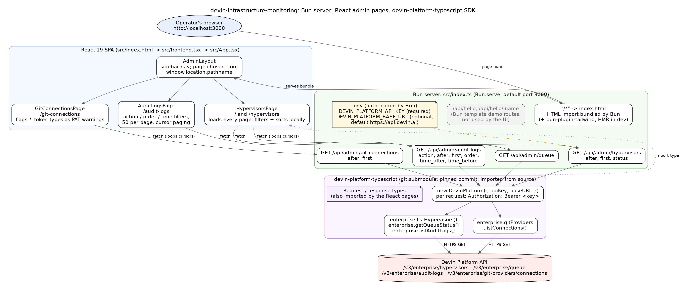

# Architecture

Devin Infrastructure Monitoring ("Devin Observability" in the UI) is a small Bun app that gives enterprise admins a read-only view of their Devin deployment: the hypervisor fleet and session queue, the enterprise audit log, and Git connections that still use personal access tokens (PATs). A single Bun process serves the React UI and a thin JSON API that calls the Devin Platform API through the `devin-platform-typescript` SDK.

The diagram source is [`diagrams/architecture.dot`](diagrams/architecture.dot) (Graphviz). After editing it, run [`diagrams/render.sh`](diagrams/render.sh) to regenerate [`architecture.png`](diagrams/architecture.png) and [`architecture.svg`](diagrams/architecture.svg). It needs Graphviz (`sudo apt-get install graphviz` or `brew install graphviz`).

## Components

| Component | Where | What it does |
| --- | --- | --- |
| Bun server | `src/index.ts` | `Bun.serve()` with an HTML-import catch-all (`/*`) and four `/api/admin/*` GET routes. Each route checks `DEVIN_PLATFORM_API_KEY`, builds a `DevinPlatform` client, calls one SDK method and returns its JSON. |
| React SPA | `src/index.html`, `src/frontend.tsx`, `src/App.tsx` | React 19 app bundled by Bun from the HTML import, styled with Tailwind v4 (`bun-plugin-tailwind`, `styles/globals.css`, `src/index.css`) and shadcn-style components in `src/components/ui`. |
| Admin pages | `src/admin/` | `AdminLayout` (sidebar) plus one page per view. `App.tsx` picks the page from `window.location.pathname`; there is no client-side router, and nav links are full page loads. |
| SDK | `devin-platform-typescript/` (git submodule) | Stainless-generated TypeScript client for the Devin Platform API, pinned to a commit and imported from source (`../devin-platform-typescript/src`), not from npm. The server uses its client; the pages import only its request and response types. |
| Build script | `build.ts` | `bun run build` bundles every `src/**/*.html` into `dist/` for the browser (minified, Tailwind plugin). |

## Pages and API routes

| Page (path) | Browser calls | Server route -> SDK method -> Platform API |
| --- | --- | --- |
| Hypervisors (`/`, `/hypervisors`; also any other unmatched path) | `GET /api/admin/queue` once, and `GET /api/admin/hypervisors?first=100&status=all[&after=...]` in a loop until `has_next_page` is false | `enterprise.getQueueStatus()` -> `GET /v3/enterprise/queue`; `enterprise.listHypervisors()` -> `GET /v3/enterprise/hypervisors` |
| Audit logs (`/audit-logs`) | `GET /api/admin/audit-logs?first=50&order=...&action=...&time_after=...&time_before=...&after=...` | `enterprise.listAuditLogs()` -> `GET /v3/enterprise/audit-logs` |
| Git connections (`/git-connections`) | `GET /api/admin/git-connections?first=100[&after=...]` in a loop until `has_next_page` is false | `enterprise.gitProviders.listConnections()` -> `GET /v3/enterprise/git-providers/connections` |

Page behavior:

- **Hypervisors** loads the whole fleet when the page opens, then filters by status (`available`, `restarting`, `disconnected`, `terminated`, `draining`) and sorts by created time or last heartbeat in the browser. Stat cards show queue size and status (`normal`, `elevated`, `high`), total, available and disconnected counts, and average utilization of available and draining hypervisors.
- **Audit logs** filters by action (list in `src/admin/auditLogActions.ts`), order and a time range (converted to Unix seconds), shows 50 entries per page, and pages with the API's `end_cursor`, keeping a stack of earlier cursors for "Previous".
- **Git connections** loads every page of connections and and marks every connection whose `git_provider_type` ends in `_token` as a PAT warning. Token values are never shown.

In `bun run dev`, `src/frontend.tsx` renders inside React `StrictMode`, so each page's load effect runs twice and every request above is sent twice per page load (for example, the queue twice and each hypervisor page twice). Production builds run the effect once.

Errors: a route returns HTTP 500 with `{ "error": "..." }` when the API key is missing or the SDK call throws, and the page shows that message.

## Configuration

Bun loads `.env` automatically.

| Variable | Required | Used for |
| --- | --- | --- |
| `DEVIN_PLATFORM_API_KEY` | Yes | Sent by the SDK as `Authorization: Bearer <key>`. Use a service user key with the `MB Service User - Observability` role (see the README). |
| `DEVIN_PLATFORM_BASE_URL` | No | Overrides the API base URL. `src/index.ts` defaults to `https://api.devin.ai`. |
| `PORT` | No | Port for `Bun.serve()`; Bun defaults to 3000. |

The key stays on the server: the browser only talks to `/api/admin/*` on the same origin.

## Run modes

- `bun run dev`: `bun --hot src/index.ts`, with HMR and browser console echo (`development` options in `src/index.ts`).
- `bun run start`: `NODE_ENV=production bun src/index.ts`. It bundles the HTML import at startup and does **not** use `dist/`.
- `bun run build`: writes a static browser bundle to `dist/`. The bundle has no API server, so the pages need the Bun server (or another backend serving `/api/admin/*`) to load data.

## Testing

The app itself has no automated tests and no CI. Checks that do run:

- Type check: `bunx tsc --noEmit -p .` passes for `src/`. Because `tsconfig.json` has no `include`, it also type-checks the submodule's Jest tests, scripts and configs and reports errors there (missing Jest types and dev dependencies).
- Build: `bun run build`.
- SDK unit tests (submodule, Jest): `cd devin-platform-typescript && npx pnpm@10.30.1 install --frozen-lockfile && ./node_modules/.bin/jest --testPathIgnorePatterns api-resources`. The `tests/api-resources` suites expect a Prism mock of the Platform OpenAPI spec on `localhost:4010`.
- `bun test` at the repo root picks up the submodule's Jest tests and runs them under Bun's runner, where some of them fail; use Jest in the submodule instead.

## Not covered by the UI

`/api/hello` and `/api/hello/:name` and `src/APITester.tsx` are left over from the Bun React template and are not used by the admin pages. The SDK exposes many more resources (organizations, sessions, members, consumption, `beta1`) than the four methods this app calls.
